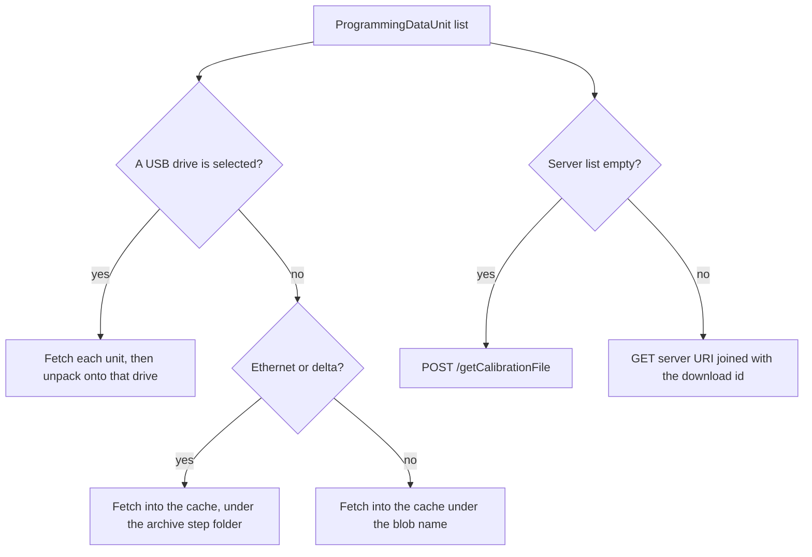

# Calibration downloads

SPS2 does not take a calibration from the CDN that serves `TUM2` and `SPS2.msi`, and SPS Info does
not return the file. The VIN catalog names the parts. A later programming-data response names the
blob, the download id, and the server list. The bytes are fetched from that list, or from
`POST /getCalibrationFile` when the list is empty.

This is the request the client makes. It is not a write to a controller. The call has not been sent
for `1G1RD6S58HU102764`, so those files are not in the cache.

## What this VIN can ask for

`ProgrammingMethodId` is the method the catalog stores. The `_BSC` ids are the same process with
`block_same_cal` set. For this VIN the catalog has only these four:

| Id | Name | Rows | `block_same_cal` | Label |
| --- | --- | --- | --- | --- |
| 1 | `NORMAL` | 4 | 0 | Normal |
| 2 | `VCI` | 4 | 0 | Programming by VCI |
| 128 | `NORMAL_BSC` | 23 | 1 | Normal |
| 256 | `VCI_BSC` | 23 | 1 | Programming by VCI |

The parts already stored for the selected sequence are `23394159` (operating system), `23394161` and
`84131365` (electronic brake, slot 2), then `23394158`, `23394157`, `23394136`, `23394154`, and
`23394155`.

USB copy is attached to a function by the server. It is not a mode the client turns on for the
whole vehicle, and it is not tied to the word "radio". The ids the client knows, with the English
labels, are:

| Id | Name | Label |
| --- | --- | --- |
| 4 | `FILE` | |
| 8 | `RECONFIGURE` | Reconfigure |
| 16 | `USB_COPY` | USB Copy |
| 32 | `USB_COPY_BY_VCI` | USB Copy by VCI |
| 64 | `MCVM` | MCVM operation selection |
| 512 | `FILE_BSC` | |
| 1024 | `RECONFIGURE_BSC` | |
| 2048 | `USB_COPY_BSC` | |
| 4096 | `USB_COPY_BY_VCI_BSC` | |
| 8192 | `MCVM_BSC` | |

`VciType` is a separate flag on a GSPAS step: `LOCAL`, `ARCHIVE`, `OVERRIDE`, or `NORMAL`. It is not
another download URL.

## Which request returns the file list

The programming-data call is chosen from the method, and each one goes through `RestTemplate` as a
path on the SPS2 service base (the base is the Techline session, not a host compiled into the jar):

| Method | Service | Path |
| --- | --- | --- |
| Normal | `ProgrammingDataService` | `/getProgrammingData` |
| VCI | `ProgrammingDataVciService` | `/getVciProgrammingData` |
| GSPAS | `ProgrammingDataGspasService` | `/getProgrammingDataGspas` |

The request carries the client state, the VIN, the programming method, and the sequence. The
response is a list of `ProgrammingDataUnit`. Each unit has a blob name, a blob size, a download id,
and a list of `DownloadServer`. A server is a `CALDownloadServer` (a URI, plus secured and Akamai
flags) or a `DLSDownloadServer` (a URI, an Akamai flag, and a description).

## Where the bytes go

`CalDownloadService.downloadFiles` sums the blob sizes, then branches on the event rather than on
the method id:

The cache directory is the preference `tdm.calibration.files.path`, and the default is
`C:\ProgramData\GM\TDM\SPS Cache`. The file name is the blob name. A later download of the same blob
name deletes the existing file and writes the new one. That is not the CDN layout, which keeps each
version in `cache/{id}/{version}/`. Two calibration versions stay side by side only when their blob
names differ.

When the server list is empty, `getUnit` posts `DownloadCalibrationFileRequest`: the service id from
the VIN, the archive flag, the blob name as the part number, and the download id. The path is
`/getCalibrationFile`. The body that comes back is an `InputStreamResponse`.

When the list is not empty, `FileDataProvider.getCalData` sends `GET` to the server URI joined with
the download id. The header is `Authorization: bearer` plus the Techline access token. An Akamai
server also gets the Akamai cookie. A 200 response is written to `{cache}/{blobName}`.
`getGspasCalData` is the same fetch for a GSPAS unit. The client retries a status other than 200.

## USB copy

The USB drive screen opens for a function only when that function's method is `USB_COPY`,
`USB_COPY_BSC`, `USB_COPY_BY_VCI`, or `USB_COPY_BY_VCI_BSC`. Normal and VCI go to the calibration
summary instead. On `1G1RD6S58HU102764` no function has those four ids. Radio (`A11`), Radio Controls
(`A22`), the Audio Amplifier (`T3`), and the Human Machine Interface (`K74`) are Normal and VCI, the
same pair as the brake module.

A GSPAS event can still open that screen without those method ids. `isLargeFileTransferUsb` is true
when any step's PCI segment is `LARGEFILETRANSFER` (3). The other large segments do not: large delta
is 2, large delta with programming is 5, large map is 10, and ethernet is 13. The fixture stored for
this VIN does not carry a PCI segment, so that flag is only visible after programming data comes
back. The landing-page mode Infotainment Service is a third list and does not itself select the USB
drive.

The download function treats the event as USB only after a drive has been selected
(`SPSModel.getSelectedUsbDrive()`). The USB screen asks for a FAT32 volume
(`select.drive.for.data.transfer.message`, `usb.drive.selection`). The summary warns that the
selected drive will be cleared before the transfer (`usb.drive.will.be.reformatted.warning`).

The file fetch is the same `getUnit` path as a normal event. After it lands, the client unpacks the
archive onto the drive. For a GSPAS USB package it then posts the VIN and a manifest file to
`POST /sps/gspas/active/vin-verification` and writes the returned hash beside the package as
`{VIN}.lic`. A GSPAS event can also upload a blob with
`PUT /sps/gspas/active/events/{id}/blob`. Neither of those is a CDN object. This VIN's catalog does
not include a USB-copy method to select.

Ethernet is the third branch (`preparing.for.ethernet`). It uses the same GET, then places the file
under the cache's archive directory for that step.
