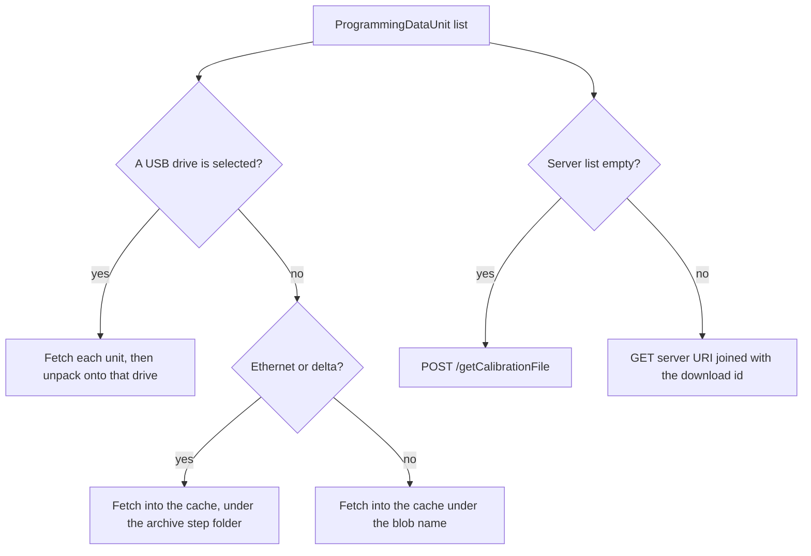

# Calibration downloads

SPS2 does not take a calibration from the CDN that serves `TUM2` and `SPS2.msi`, and SPS Info does
not return the file. The VIN catalog names the parts. A later programming-data response names the
blob, the download id, and the server list. The bytes are fetched from that list, or from
`POST /getCalibrationFile` when the list is empty.

This is the request the client makes. It is not a write to a controller. The call has not been sent
for `1G1RD6S58HU102764`, so those files are not in the cache.

## What this VIN can ask for

`ProgrammingMethodId` is the method the catalog stores. The `_BSC` ids are the same process with
`block_same_cal` set. For this VIN the catalog has only these four:

| Id | Name | Rows | `block_same_cal` | Label |
| --- | --- | --- | --- | --- |
| 1 | `NORMAL` | 4 | 0 | Normal |
| 2 | `VCI` | 4 | 0 | Programming by VCI |
| 128 | `NORMAL_BSC` | 23 | 1 | Normal |
| 256 | `VCI_BSC` | 23 | 1 | Programming by VCI |

The parts already stored for the selected sequence are `23394159` (operating system), `23394161` and
`84131365` (electronic brake, slot 2), then `23394158`, `23394157`, `23394136`, `23394154`, and
`23394155`.

USB copy is attached to a function by the server. It is not a mode the client turns on for the
whole vehicle, and it is not tied to the word "radio". The ids the client knows, with the English
labels, are:

| Id | Name | Label |
| --- | --- | --- |
| 4 | `FILE` | |
| 8 | `RECONFIGURE` | Reconfigure |
| 16 | `USB_COPY` | USB Copy |
| 32 | `USB_COPY_BY_VCI` | USB Copy by VCI |
| 64 | `MCVM` | MCVM operation selection |
| 512 | `FILE_BSC` | |
| 1024 | `RECONFIGURE_BSC` | |
| 2048 | `USB_COPY_BSC` | |
| 4096 | `USB_COPY_BY_VCI_BSC` | |
| 8192 | `MCVM_BSC` | |

`VciType` is a separate flag on a GSPAS step: `LOCAL`, `ARCHIVE`, `OVERRIDE`, or `NORMAL`. It is not
another download URL.

## Which request returns the file list

The programming-data call is chosen from the method, and each one goes through `RestTemplate` as a
path on the SPS2 service base (the base is the Techline session, not a host compiled into the jar):

| Method | Service | Path |
| --- | --- | --- |
| Normal | `ProgrammingDataService` | `/getProgrammingData` |
| VCI | `ProgrammingDataVciService` | `/getVciProgrammingData` |
| GSPAS | `ProgrammingDataGspasService` | `/getProgrammingDataGspas` |

The request carries the client state, the VIN, the programming method, and the sequence. The
response is a list of `ProgrammingDataUnit`. Each unit has a blob name, a blob size, a download id,
and a list of `DownloadServer`. A server is a `CALDownloadServer` (a URI, plus secured and Akamai
flags) or a `DLSDownloadServer` (a URI, an Akamai flag, and a description).

## Where the bytes go

`CalDownloadService.downloadFiles` sums the blob sizes, then branches on the event rather than on
the method id:

The cache directory is the preference `tdm.calibration.files.path`, and the default is
`C:\ProgramData\GM\TDM\SPS Cache`. The file name is the blob name. A later download of the same blob
name deletes the existing file and writes the new one. That is not the CDN layout, which keeps each
version in `cache/{id}/{version}/`. Two calibration versions stay side by side only when their blob
names differ.

When the server list is empty, `getUnit` posts `DownloadCalibrationFileRequest`: the service id from
the VIN, the archive flag, the blob name as the part number, and the download id. The path is
`/getCalibrationFile`. The body that comes back is an `InputStreamResponse`.

When the list is not empty, `FileDataProvider.getCalData` sends `GET` to the server URI joined with
the download id. The header is `Authorization: bearer` plus the Techline access token. An Akamai
server also gets the Akamai cookie. A 200 response is written to `{cache}/{blobName}`.
`getGspasCalData` is the same fetch for a GSPAS unit. The client retries a status other than 200.

## Reprogram

Reprogram is a programming mode (`programming.mode.reprogram`). SPS2 26.10.27 does not give that
mode its own path. `DOWNLOAD_PROG_FILES_TASK` fetches every unit the programming-data response
named, through the GET and the `/getCalibrationFile` POST above. `REPROGRAM_VEHICLE_TASK` then
reads those blobs (`getCalibrationFiles`, `getProgrammingDataUnits`).

That is the older client. The vehicle software file is a separate object in SPS3 26.10.27
(`SPS3.jar`), the vehicle-wide programming client from the same cache generation. SPS2's
`currentSoftware` and `selectedSoftware` are summary fields on `SPSModule`. They are not the
download. The word firmware in the SPS2 jar is the J2534 tool's own version (`J2534Version`). A
type-4 event is `POST /getType4App`, and it is not this download.

## Vehicle software parts

SPS3 asks for the files after it has the functional steps:

`POST {base.url}/sps/gspas/active/vehicles/ecus/functionalSteps/parts`

The body is a `VehicleModel`: the event and the vehicle, including the ECUs that were selected.
`{base.url}` is the Techline session base, the same kind of value SPS2 reads from
`ClientApplicationContext.getServerUrl()`. It is not compiled into the jar.

Each part in that response carries `number`, `url`, `checkSum`, `size`, and `moduleId`. A part may
also carry `manifestPart`, `signaturePart`, and `internalParts`. The operating-system slot in this
VIN's catalog is part `23394159`. In SPS3 that number is its own part, with its own URL, beside the
calibration part numbers. The parts response is what fills the URL. This call has not been sent, so
the URL for `23394159` is not known yet.

Parts that already have a checksum, a number, a URL, and a size are downloaded. Missing any of
those, the client skips the part. One token is requested per part that is not already in the cache:

`POST {base.url}/cdn/files/gspas/credentials`

The body is `{"numberOfTokens": N}`. The response is `{"tokens": [...]}`. The header map is the
SPS3 session token from `AuthenticationService.getSps3Token`.

The file GET is `{part.url}/{part.number}`. The token is sent as the `Cookie` header, not as
`Authorization`. A follow-up request for a chunk adds a `Range` header. The joined file is checked
against `checkSum` and written to `%USERPROFILE%\sps\spsCache\spsCacheInternal\{number}`. A file
already there under that number is not fetched again.

After the package is on disk, the manifest is `{number}.mnf` and the signature is `{number}.smd`.
`internalParts` are the files inside that package, looked up by part number. The native programming
library (`spsvcs.dll` 7.2.11) keeps an application-software partition and a calibration partition as
separate names in its error strings. The manifest is what says which internal part is which. This
note stops at the file on disk. It does not describe writing either partition to a controller.

`TechUpdate`, `ForceTechUpdate`, `TechResidentUpdate`, and `GetPossibleSWDLActions` are exports of
that same DLL. In this build the `TechUpdate` export logs the call and returns without building a
URL. The download the Java client actually performs is the parts POST and the per-part GET above.

## USB copy

The USB drive screen opens for a function only when that function's method is `USB_COPY`,
`USB_COPY_BSC`, `USB_COPY_BY_VCI`, or `USB_COPY_BY_VCI_BSC`. Normal and VCI go to the calibration
summary instead. On `1G1RD6S58HU102764` no function has those four ids. Radio (`A11`), Radio Controls
(`A22`), the Audio Amplifier (`T3`), and the Human Machine Interface (`K74`) are Normal and VCI, the
same pair as the brake module.

A GSPAS event can still open that screen without those method ids. `isLargeFileTransferUsb` is true
when any step's PCI segment is `LARGEFILETRANSFER` (3). The other large segments do not: large delta
is 2, large delta with programming is 5, large map is 10, and ethernet is 13. The fixture stored for
this VIN does not carry a PCI segment, so that flag is only visible after programming data comes
back. The landing-page mode Infotainment Service is a third list and does not itself select the USB
drive.

Once a drive is selected, USB Copy and a large-file step use the same fetch. The programming-data
response is what names the file. USB Copy and USB Copy with block-same-cal use `/getProgrammingData`.
USB Copy by VCI uses `/getVciProgrammingData`. A GSPAS large-file step uses `/getProgrammingDataGspas`.
Each unit in that response has a blob name, a blob id, a download id, and the server list. The SPS2
service base is `ClientApplicationContext.getServerUrl()`, filled from the Techline session. It is
not compiled into the jar.

`CalDownloadService.download` then does two attempts, in order:

1. `GET {server URI}/{downloadId}` with `Authorization: bearer` and the Techline access token. An
   Akamai server also sends the Akamai cookie. A 200 is written to `{SPS cache}/{blobName}`. The
   default cache is `C:\ProgramData\GM\TDM\SPS Cache`. The same blob name replaces the file already
   there.
2. If that GET fails, or the server list is empty, `POST {serverUrl}/getCalibrationFile`. The body
   is `DownloadCalibrationFileRequest`: the VIN's service id, `isArchive` false, `partNo` set to the
   blob name, and download id `0`. The response stream is written to the same cache path.

The zip is then unpacked at the root of the selected drive. The client writes
`indication.{blobName}.{blobId}` there, one line, the unit checksum in hex. A later run that finds
a matching indication file skips the unpack. A GSPAS package that contains a `.mnf` entry also
`POST`s `/sps/gspas/active/vin-verification` (the VIN plus that manifest as the `file` part) and
writes the returned hash as `{VIN}.lic` on the drive. A package with no `.mnf` skips the license
file. A GSPAS event can upload a blob with `PUT /sps/gspas/active/events/{id}/blob`.

For PCI segment 3 the download is the whole step. After the package validates, the client marks
that step successful and does not keep going into the normal calibration summary. Segments 2, 5,
10, and 13 stay on the cache path: ethernet and delta files land under `{cache}/archive/{stepId}/`,
and an ethernet blob uses the `.smd` extension.

None of these objects are on the CDN that served `SPS2.msi`. This VIN's catalog has no USB-copy
method, and the stored fixture has no PCI segment, so the blob name and the server URI are not
known until one of those programming-data calls returns.
