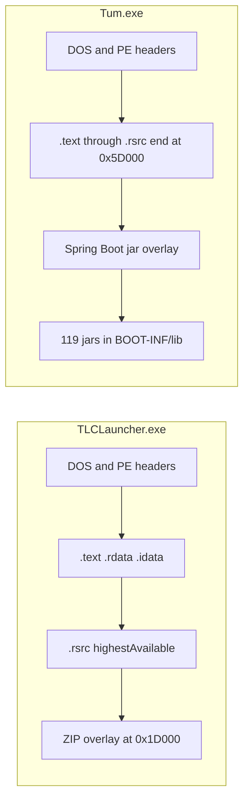
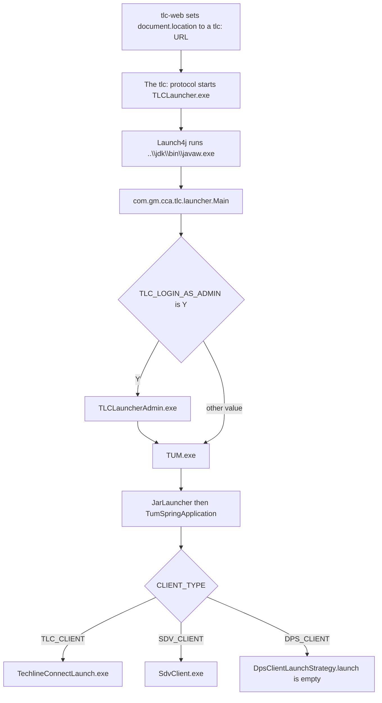
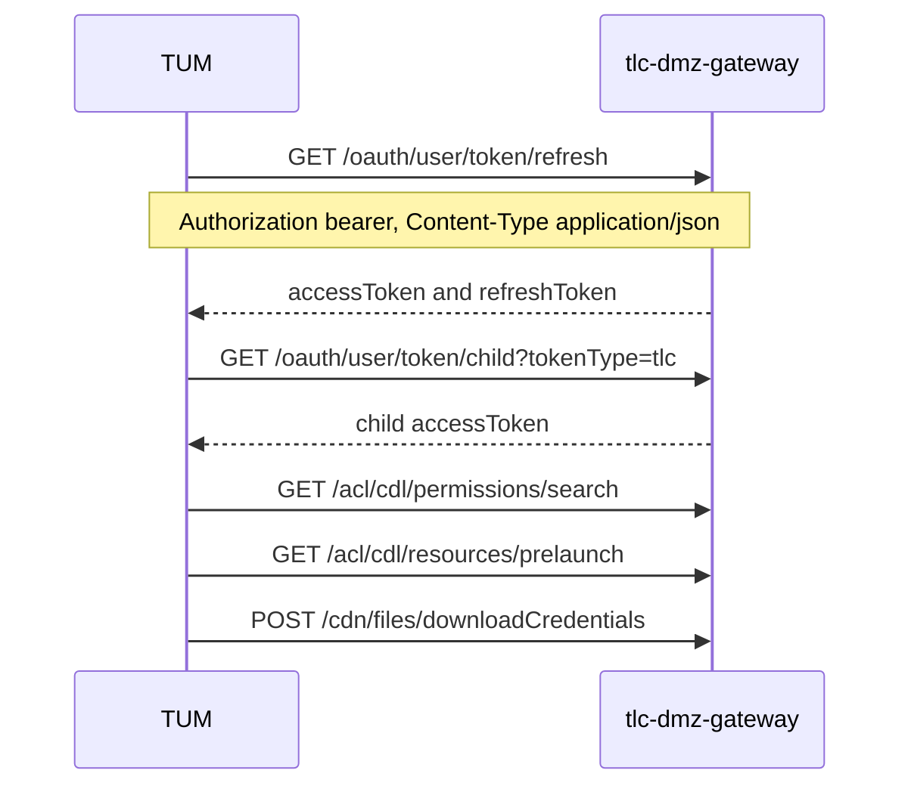

# Techline Connect binaries

`TLCSuite.exe` 26.8.31.0 expands to three application executables. Each one is a 32-bit Launch4j
stub (`machine` `0x14c`, PE32) with a zip archive appended after the last section. The stub finds a
JRE and starts Java. The archive is the program. `TechlineConnectLaunch.exe` and `SdvClient.exe`
are named by that Java and are not bytes inside this installer.

The copies, the extracted jars, the binwalk logs, and the jadx tree live in `local/tlc/`. That
directory is gitignored.

## How they were opened

The zip overlay starts at the first `PK\x03\x04` and is a normal jar. Python `zipfile` extracts it.
binwalk reports the same offset, and on `Tum.exe` it also reports every nested jar inside
`BOOT-INF/lib`. Ghidra loads only the PE image. The overlay is past the last section, so it is not
in the Ghidra address space.

| File | Size | Sections end | Zip | Zip entries | Image in Ghidra |
| --- | ---: | ---: | ---: | ---: | --- |
| `TLCLauncher.exe` | 4,496,120 | `0x1D000` | `0x1D000` | 2,707 | `00400000`–`0042abff`, 82 functions |
| `TLCLauncherAdmin.exe` | 4,496,120 | `0x1D000` | `0x1D000` | 2,707 | same layout, not imported |
| `Tum.exe` | 67,424,933 | `0x5D000` | `0x5D000` | 397 | stub only; the jar is the overlay |

binwalk's first hit on `Tum.exe` is that outer zip at `0x5D000`. The later zip hits are the 119
jars under `BOOT-INF/lib`. `zipfile` opens the outer archive as one file of 397 entries.

## Launch4j stub

The strings in the stub, before the zip, are the Launch4j search: `findRegistryJavaHome`,
`bundledJreSearch` on `Tum.exe`, `SOFTWARE\JavaSoft\Java Runtime Environment`, `bin\javaw.exe`,
and `..\jdk`. `Tum.exe` also carries `-Djava.library.path=../jdk` and the main class
`org.springframework.boot.loader.JarLauncher`. The two launchers carry the main class
`com.gm.cca.tlc.launcher.Main` and a classpath of `log4j-api-2.17.1.jar`, `log4j-core-2.17.1.jar`,
`commons-io-2.11.0.jar`, and `lombok-1.18.22.jar`. Those libraries are already inside the appended
jar. The launcher classpath names the window title `tlc-launcher-client`. The admin copy names it
`TLC Launcher`.

Ghidra imported `TLCLauncher.exe` as `/tlc/TLCLauncher.exe`, language `x86:LE:32:default`, compiler
`windows`. Analysis finished with 82 functions. The imports that do the work are `RegOpenKeyExA`,
`RegQueryValueExA`, `RegEnumKeyExA`, `FindResourceExA`, `LoadResource`, `CreateProcessA`,
`CreatePipe`, `GetCommandLineA`, and `CreateMutexA`. The entry label is `00401590`. Ghidra did not
make a function there, and it defined no strings, so the Launch4j messages stayed in the section
bytes. The mapped image ends at `0042abff`. That is the stub. The jar begins at file offset
`0x1D000` and is outside that image.

Both launcher manifests request `highestAvailable`. The uncompressed class files in the two
launcher zips are the same bytes. The zip containers differ, which is why the file hashes differ.
The Java still restarts through `TLCLauncherAdmin.exe` when `TLC_LOGIN_AS_ADMIN` is `Y`, and it
rewrites that field to `Y-restarted` so the second process does not restart again.

`tlc-launcher-client` is Maven version `26.4.23.0`, group `com.gm.cca.tlc`, built with JDK 11.
The manifest has no `Main-Class`. Launch4j supplies `com.gm.cca.tlc.launcher.Main`. The jar holds
1,686 classes and 12 classes under `com.gm.cca.tlc.launcher`.

## From the browser to the client

The launcher reads one `tlc:,` string and splits on commas. Thirteen fields are required. A
fourteenth value may be `installTum` or `revertTum`, which runs `msiexec /i tumApp.msi /qb` or
`msiexec /x tumApp.msi /qb` from `%ProgramData%\TechlineConnect\TUM\temp`. The working directory
for the TUM process is `C:/Program Files/TechlineConnect`. The command is `cmd /C` plus the
executable path.

TUM reads thirteen separate arguments. The first eight names match the launcher. The last five
do not.

| Index | Launcher field | TUM field |
| --- | --- | --- |
| 1 | `TLC_BROWSE_LAUNCH` | `TLC_BROWSE_LAUNCH` |
| 2 | `TLC_ENVIRONMENT` | `TLC_ENVIRONMENT` |
| 3 | `TLC_LOGIN_SESSION_ID` | `TLC_LOGIN_SESSION_ID` |
| 4 | `TLC_LOGIN_SECURITY_ID` | `TLC_LOGIN_SECURITY_ID` |
| 5 | `TLC_LOGIN_JSESSION_ID` | `TLC_LOGIN_JSESSION_ID` |
| 6 | `TLC_LOGIN_SI_AUTH` | `TLC_LOGIN_SI_AUTH` |
| 7 | `TLC_LOGIN_AS_ADMIN` | `TLC_LOGIN_AS_ADMIN` |
| 8 | `TLC_TDS_REST_TOKEN` | `TLC_TDS_REST_TOKEN` |
| 9 | `TLC_ACCESS_TOKEN` | `ACCESS_TOKEN` |
| 10 | `TLC_REFRESH_TOKEN` | `REFRESH_TOKEN` |
| 11 | `IBM_GATEWAY_URI` | `GATEWAY_URI` |
| 12 | `IBM_CLIENT_ID` | `VIN` |
| 13 | `IBM_CLIENT_SECRET` | `CLIENT_TYPE` |

`CLIENT_TYPE` is `TLC_CLIENT`, `SDV_CLIENT`, `DPS_CLIENT`, or anything else, which becomes
`UNKNOWN`. If the access-token payload contains `ocp-epg3im3.epg.nam.gm.com`, TUM rewrites the
environment to the OpenShift name (`prod`, `dev`, `validation`, `currentState`, `futureState`).
Otherwise it rewrites it to the Azure name (`productionAzure`, `devAzure`, `validationAzure`,
`currentStateAzure`, `futureStateAzure`).

`TLC_CLIENT` calls `retrieveTlcToken` up to three times, stores the returned access and refresh
tokens over the startup values, and starts
`C:\Program Files\TechlineConnect\TechlineConnectLaunch.exe` with TUM's thirteen arguments.
`SDV_CLIENT` starts `C:\Program Files\Sdv Client\SdvClient.exe` with the environment, a user id
taken from the session id, the access token, the refresh token, and the VIN. `DPS_CLIENT` returns
immediately. The first argument `Uninstall` puts TUM into uninstall mode.

`TumSpringApplication` clears `%USERPROFILE%\TechlineConnect\TUM\logs\tum.log`, calls
`BundledTrustStoreBootstrap.tryInstall`, and opens the JavaFX window. JDBC and Hibernate
autoconfiguration are excluded. Logging of `com.gm.tlc.tum` is `debug`.

## Gateway calls inside TUM

`ClientHelper.buildFeignClientHeaderMap` sets two headers:

- `Authorization` is the literal `bearer ` followed by the TUM access token
- `Content-Type` is `application/json`

`AuthorizationServiceClient` is Feign client `authorization.service.client` at `${base.url}/oauth`.
It has `GET /user/token/refresh` and `GET /user/token/child`. The child call passes `tokenType`,
and `AuthenticationService.retrieveTlcToken` uses the value `tlc`. A null access token or a null
refresh token shuts TUM down. The refresh failure string is `Unable to refresh TUM token`. The
child-token failure string is `Unable to retrieve TLC token`.

`AclServiceClient` is `${base.url}/acl`. It has `GET /cdl/permissions/search` and
`GET /cdl/resources/prelaunch`. `CdnServiceClient` is `${base.url}/cdn` with
`POST /files/downloadCredentials`. `CdlResourceIds.TUM_ID` is `1`.

`application.yml` selects `base.url` from the Spring profile:

| Profile | Base URL |
| --- | --- |
| `prod`, `productionOcp`, `productionAzure` | `https://tlc-dmz-gateway.ext.gm.com` |
| `validation`, `validationOcp`, `validationAzure` | `https://tlc-dmz-gateway-val.ext.gm.com` |
| `simulation` | `https://tlc-dmz-gateway-sim.ext.gm.com` |
| `dev` | `https://tlc-dmz-gateway-dev.ocp-epg-d3-06m1.dev.gm.com` |
| `devAzure` | `https://tlc-dmz-gateway-dev.gm.com` |
| `currentState` | `https://tlc-dmz-gateway-cs.ocp-epg-d3-06m1.dev.gm.com` |
| `currentStateAzure` | `https://tlc-dmz-gateway-cs.gm.com` |
| `futureState` | `https://tlc-dmz-gateway-fs.ocp-epg-d3-06m1.dev.gm.com` |
| `futureStateAzure` | `https://tlc-dmz-gateway-fs.gm.com` |
| `local` | `http://localhost:8122` |

The web page's installer call is `POST /cdn/files/public/downloadCredentials` for resource 25.
TUM's call is `POST /cdn/files/downloadCredentials` and its resource id is `1`. The browser child
token captured for SPS Info used `tokenType=sps-info`. TUM asks for `tokenType=tlc`.

## What TUM contains

The manifest is `Implementation-Title: TUM`, `Implementation-Version: 26.8.28.0`,
`Main-Class: org.springframework.boot.loader.JarLauncher`,
`Start-Class: com.gm.tlc.tum.TumSpringApplication`, `Spring-Boot-Version: 2.5.12`,
`Build-Jdk-Spec: 11`. `client.properties` repeats `tum.version=26.8.28.0`.

There are 115 classes under `com.gm.tlc.tum` and 100 of them are top-level. The packages are
`controller`, `feign`, `services` (including `auth`, `strategy.launch`, `legacy`, and `proxy`),
`security`, `startup`, `model`, and `util`. The nested libraries include Spring Boot 2.5.12,
Spring Framework 5.3.18, JavaFX 11, OpenFeign, Bouncy Castle 1.68, and `satin-core` 2.1.0.

Paths TUM builds from `user.home`, `ProgramData`, `ProgramFiles(x86)`, and `ProgramW6432`:

- `%USERPROFILE%\TechlineConnect`
- `%ProgramData%\TechlineConnect\TUM`
- `C:\Program Files\TechlineConnect\TechlineConnectLaunch.exe`
- `C:\Program Files\TechlineConnect\TUM\TLCLauncher.exe`
- `C:\Program Files\Sdv Client\SdvClient.exe`
- `%ProgramData%\GM\TDM` and the GDS 2 download folders under `PersistentData\Downloads`

## What is still outside this installer

`TechlineConnectLaunch.exe` and `SdvClient.exe` are the next files to open. The launch classes
only store their paths and the argument list. When one of them is a Launch4j stub, the same zip
cut used here recovers the jar. When the cut finds no zip, that file is the one to load in
Ghidra.
